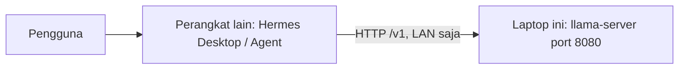

# Roadmap: Laptop sebagai Server LLM, Hermes di Perangkat Lain

Dokumen ini adalah rencana tunggal untuk setup yang sudah diputuskan.

Laptop Ubuntu (user `fahmi`) menjadi **server LLM** yang hanya menghasilkan token. Hermes Desktop / Hermes Agent berjalan di **perangkat lain**. Perangkat itu yang memegang tool, file, shell, memori, dan sesi. Keduanya berbicara lewat LAN. Balasan boleh lambat. Yang wajib adalah mesin tidak membeku.

Tidak ada MySQL dan tidak ada PostgreSQL. Memori agen berupa file di `~/.hermes` pada mesin tempat Hermes berjalan.

Hari ini laptop ini masih Ubuntu Desktop 26.04 dengan Hermes Desktop. Peran targetnya adalah Ubuntu Server yang dedicated. Bagian di bawah menggantikan rencana lama (Hermes gateway + Ollama + bot Telegram di laptop ini).

Telegram dan channel lain tetap bisa dipasang nanti, di **perangkat Hermes**, lewat gateway Hermes. Laptop LLM tidak menjalankan bot.

---

## 1. Tujuan dan arsitektur



| Sisi | Mesin | Yang berjalan | Yang disimpan |
| :--- | :--- | :--- | :--- |
| Server LLM | Laptop ini | Satu proses `llama-server` (llama.cpp, Vulkan) | Satu file GGUF, unit systemd, file flag |
| Agen | Perangkat lain | Hermes Desktop / Agent | `~/.hermes`: memori, sesi, skill, SOUL, cron, config |

Alur satu pesan:

1. Kamu bicara ke Hermes (Desktop, atau nanti Telegram di perangkat yang sama).
2. Hermes mengirim permintaan chat ke `http://<ip-laptop>:8080/v1`.
3. Laptop menghitung token dan mengembalikan teks.
4. Kalau model meminta tool, **Hermes** yang menjalankan file dan shell. Laptop tidak menerima `--tools` atau `--agent` dari llama-server.

Satu proses `llama-server` memuat satu GGUF ke RAM saat proses itu start (atau setelah model sempat di-unload). Pesan berikutnya tidak memuat ulang bobot dari disk.

Beberapa bot di dalam **satu** proses Hermes berbagi satu model yang sudah dimuat. Dua proses Hermes yang masing-masing menyalakan runtime lokal, atau dua model berbeda, masing-masing memuat bobot sendiri dan tidak muat di RAM 16 GB. Pada rencana ini runtime lokal Hermes mati, dan semua klien menunjuk ke satu `llama-server`, jadi bobot hanya ada satu salinan di laptop. Dua klien itu mengantri di satu slot (`--parallel 1`).

---

## 2. Spesifikasi

### 2.1 Sekarang (sekitar 16 GB)

| Item | Nilai |
| :--- | :--- |
| CPU | Intel Core i5-1250P, 12 core / 16 thread. Tidak ada NVIDIA. CPU ini tidak punya NPU. NPU juga bukan tempat menjalankan asisten 4B/9B. |
| Grafis | Intel Alder Lake-P iGPU saja. RAM terpadu (unified). Akselerasi yang dipakai: Vulkan. |
| RAM | 14,8 GB. Anggaran yang aman untuk Hermes dulu sekitar 11,8 GB setelah headroom 20%. |
| Heap GPU yang terukur | `llama-server --list-devices` pada build yang ada hari ini: `Vulkan0: Intel(R) Graphics (ADL GT2)`, sekitar 11354 MiB. Angka free berubah sesuai pemakaian. Cek lagi setelah Desktop dilepas. |
| Disk | Sekitar 149 GB kosong. Cukup untuk GGUF 4B, dan nanti 14B atau 27B Q4. Model 90 GB ke atas tetap tidak muat. |
| OS hari ini | Ubuntu Desktop 26.04 + Hermes Desktop. Target: Ubuntu Server, dedicated. |

**Model yang dijalankan di tahap ini**

- Repo: `unsloth/Qwen3.5-4B-GGUF`
- File: `Qwen3.5-4B-UD-Q8_K_XL.gguf` (sekitar 5,5 GB)
- Context di server: **16384**
- Kalau swap naik atau mesin membeku: turunkan ke **8192** di server dan di Hermes. Jangan naikkan ukuran model dulu.
- Tool calling dan bahasa Indonesia: dipakai sebagaimana model ini.

File itu sekarang ada di `~/.hermes/models/` bersama `Qwen3.5-9B-Q6_K.gguf` (sekitar 6,9 GB). File 9B **tidak** di-load pada RAM 16 GB. Simpan sebagai cadangan offline.

Kenapa 9B dan 4B pernah membekukan mesin (harus power-off):

- Qwen3.5-9B-Q6_K pada context panjang duduk di sekitar 11,5 GB, hampir sama dengan anggaran 11,8 GB.
- Qwen3.5-4B Q8 juga membeku saat Hermes Desktop masih berjalan dan context window di UI diisi **0**. Nilai 0 berarti "pakai window penuh model". Window itu sangat besar dan menghabiskan RAM.

Di server dedicated, Hermes tidak ikut memakan RAM laptop, dan context dikunci 16384 saat proses start. Itu yang membuat 4B layak dicoba lagi. Tetap awasi `free -h` pada start pertama.

**Sebelum membeli RAM 32 GB**, cek apakah RAM mesin ini tersolder. Sebagian laptop P-series generasi ke-12 menyolder RAM, jadi modul SODIMM tidak bisa dipasang.

```bash
sudo dmidecode -t memory
```

Lihat jumlah slot, `Locator`, `Size`, dan apakah ada slot kosong. Kalau ragu, buka penutup bawah dan pastikan ada slot SODIMM sebelum membeli.

### 2.2 Setelah RAM 32 GB

Perkiraan anggaran setelah headroom 20%: sekitar 25 GB. Engine tetap llama.cpp. Yang diganti: file GGUF, dan context hanya jika pengukuran bilang begitu.

| Model | Keputusan |
| :--- | :--- |
| Qwen3.5 14B Q5 atau Q6, context 16384 | Target upgrade. Muat dengan longgar. |
| Qwen3.8 27B Q4 (bobot sekitar 15 GB; perkiraan kebutuhan sebelumnya sekitar 21 GB) | Mungkin muat hanya jika context tetap dibatasi. Ukur setelah RAM terpasang, sebelum dijadikan model harian. |
| Model 90 GB ke atas | Tetap tidak muat. |

Urutan ganti model setelah RAM baru terpasang dan `free -h` menunjukkan sekitar 32 GB:

1. Unduh GGUF 14B ke direktori model server.
2. Ubah path dan alias di file env, restart `llama-server`.
3. Samakan nama model dan context di Hermes.
4. Baru pertimbangkan 27B Q4, dengan context yang sama-sama dibatasi, sambil menonton RAM saat start.

---

## 3. Ollama atau llama.cpp

Keduanya bisa jalan di Ubuntu Server yang sama. Keduanya tidak butuh database. API keduanya bisa dibuat kompatibel dengan OpenAI. Yang dipilih untuk server ini: **llama.cpp `llama-server`**.

| | Ollama | llama.cpp `llama-server` |
| :--- | :--- | :--- |
| Bentuk model | Tag / Modelfile, di dalamnya tetap GGUF | Satu file GGUF, path ditulis di flag |
| Context | Default sering 4096. Diubah lewat environment atau Modelfile | Dikunci saat proses start dengan `--ctx-size`. Nilai 0 = window dari metadata model (inilah yang menghabiskan RAM) |
| Ganti model | Lebih mudah untuk bolak-balik | Ganti path file, lalu restart layanan |
| Kejutan RAM | Context bisa lain dari yang kamu kira kalau env tidak di-set | Context yang memesan RAM adalah angka di proses server |

Alasan memilih llama.cpp: satu GGUF, context tidak berubah diam-diam di tengah jalan. Ollama tetap pilihan yang lebih enak untuk berganti model, dan bukan mesin yang dipakai di rencana ini.

---

## 4. Langkah server Ubuntu

Urutan fase:

```
Fase 0  Salin GGUF dan, kalau agen ikut pindah, backup ~/.hermes  SEBELUM format
Fase 1  Pasang Ubuntu Server
Fase 2  Tutup laptop tetap menyala
Fase 3  IP LAN tetap (reservasi DHCP atau static)
Fase 4  UFW: 8080 hanya dari LAN
Fase 5  Build llama.cpp dengan Vulkan
Fase 6  Taruh GGUF 4B
Fase 7  Uji llama-server manual
Fase 8  systemd, enable setelah uji lolos
```

Flag di bawah dicek pada dua sumber: README upstream `tools/server/README.md` dan `docs/build.md` (repo `ggml-org/llama.cpp`), serta `llama-server --help` build **0.7.0-dev (build 11671)** yang ada di mesin ini. Jangan menyalin default port dari ingatan: pada kedua sumber itu `--port` default **9931** dan `--host` default **127.0.0.1**. Rencana ini mengunci port **8080** lewat flag, supaya URL Hermes tetap `http://<ip-laptop>:8080/v1`.

### Fase 0 — Selamatkan file sebelum Ubuntu Server

Format menghapus `~/.hermes/models/`. Salin dulu ke disk lain:

```bash
ls -lh ~/.hermes/models
# yang dipakai server:
#   Qwen3.5-4B-UD-Q8_K_XL.gguf
# simpan offline, jangan di-load di 16 GB:
#   Qwen3.5-9B-Q6_K.gguf
```

Kalau percakapan, skill, dan SOUL di laptop ini ingin pindah ke perangkat Hermes, buat arsip state dulu (perintahnya di bagian 7.1) lalu salin arsip itu juga ke disk lain. Bobot model dan state agen adalah dua salinan terpisah.

### Fase 1 — Ubuntu Server

Pasang Ubuntu Server baru. Layar installer, checksum ISO, dan USB ada di [install_ubuntu_server.md](install_ubuntu_server.md). Buat user `fahmi`. Saat installer, ikutkan OpenSSH supaya laptop headless masih bisa dimasuki dari LAN.

Setelah boot, masukkan user ke grup yang membuka iGPU:

```bash
sudo usermod -aG render,video fahmi
```

Logout/login (atau reboot) supaya grup aktif.

### Fase 2 — Tetap menyala saat tutup

```bash
sudo mkdir -p /etc/systemd/logind.conf.d
sudo tee /etc/systemd/logind.conf.d/no-sleep.conf >/dev/null <<'EOF'
[Login]
HandleLidSwitch=ignore
HandleLidSwitchExternalPower=ignore
HandleLidSwitchDocked=ignore
IdleAction=ignore
EOF
sudo systemctl restart systemd-logind
sudo systemctl mask sleep.target suspend.target hibernate.target hybrid-sleep.target
```

Colok listrik. Laptop ini server, bukan mesin yang boleh suspend di tengah generasi.

### Fase 3 — IP LAN yang tidak berubah

Pilih salah satu.

**Lebih sederhana:** reservasi DHCP di router, diikat ke MAC laptop, supaya alamat LAN selalu sama.

**Di laptop sendiri**, netplan static. Ganti nama interface, alamat, dan gateway dengan nilai LAN kamu. Nama interface dari `ip -br link`. Kabel Ethernet lebih stabil daripada Wi-Fi.

```bash
ip -br link
```

Contoh `/etc/netplan/01-lan.yaml` (alamat di sini hanya contoh):

```yaml
network:
  version: 2
  ethernets:
    enp0s31f7:
      dhcp4: false
      addresses:
        - 192.168.1.50/24
      routes:
        - to: default
          via: 192.168.1.1
      nameservers:
        addresses: [192.168.1.1, 1.1.1.1]
```

```bash
sudo netplan apply
ip -br addr
```

Alamat inilah yang nanti diisi ke `--host` dan ke base URL Hermes. Ikat ke **IP LAN laptop**, misalnya `192.168.1.50`. Biarkan default `127.0.0.1` hanya untuk uji di laptop sendiri; Hermes di perangkat lain tidak bisa menjangkaunya. `0.0.0.0` membuka semua interface, termasuk interface yang menghadap internet kalau ada, jadi tidak dipakai.

### Fase 4 — Firewall

Ganti `192.168.1.0/24` dengan prefix LAN yang sebenarnya. SSH ikut dibuka hanya untuk subnet yang sama, supaya `ufw enable` tidak mengunci kamu di luar.

```bash
sudo ufw default deny incoming
sudo ufw default allow outgoing
sudo ufw allow from 192.168.1.0/24 to any port 22 proto tcp
sudo ufw allow from 192.168.1.0/24 to any port 8080 proto tcp
sudo ufw enable
sudo ufw status verbose
```

Tidak ada aturan "allow 8080 from anywhere".

### Fase 5 — llama.cpp dengan Vulkan

Paket build mengikuti `docs/build.md` untuk Debian/Ubuntu, ditambah driver Intel dan `vulkaninfo`. Nama paket ini ada di arsip Ubuntu mesin ini.

```bash
sudo apt-get update
sudo apt-get install -y build-essential cmake git pkg-config \
  libvulkan-dev glslc spirv-headers mesa-vulkan-drivers vulkan-tools
vulkaninfo --summary
```

`vulkaninfo` harus melihat Intel Graphics sebelum compile dilanjutkan.

```bash
git clone https://github.com/ggml-org/llama.cpp.git "$HOME/llama.cpp"
cd "$HOME/llama.cpp"
cmake -B build -DGGML_VULKAN=1
cmake --build build --config Release
```

`-DGGML_VULKAN=1` dan `-DGGML_VULKAN=ON` sama-sama dipakai di dokumen upstream. Bentuk `1` adalah perintah di bagian Linux.

Cek perangkat, tanpa memuat model:

```bash
"$HOME/llama.cpp/build/bin/llama-server" --list-devices
```

Yang diharapkan bentuknya seperti hasil hari ini: `Vulkan0: Intel(R) Graphics (ADL GT2)`. Pakai nama di kolom kiri itu sebagai `--device`. Heap perangkat adalah irisan RAM yang sama, bukan VRAM tambahan. Vulkan memindahkan hitungan ke iGPU; tagihan RAM tetap satu kolam. Log saat model dimuat sebaiknya menyebut `ggml_vulkan` dan Intel Graphics (contoh upstream untuk chip sekelas: `uma: 1`).

Binary yang dijalankan: `llama-server` di `build/bin/`. Jalankan dari pohon build itu supaya library di sampingnya ikut ketemu.

### Fase 6 — Letakkan GGUF

```bash
mkdir -p "$HOME/llama-models"
# salin dari disk cadangan, bukan dari dalam arsip state Hermes
cp -n /path/cadangan/Qwen3.5-4B-UD-Q8_K_XL.gguf "$HOME/llama-models/"
ls -lh "$HOME/llama-models"
```

Satu file yang dilayani. File 9B tidak ditaruh di path yang di-start layanan ini.

### Fase 7 — Uji manual dulu

File flag kecil, `/etc/llama-server/llama.env`. Tidak ada token di file ini.

```bash
sudo mkdir -p /etc/llama-server
sudo tee /etc/llama-server/llama.env >/dev/null <<'EOF'
# Angka dan path yang memesan RAM / mengikat jaringan.
# Ganti LLAMA_HOST dengan IP LAN laptop. Bukan 127.0.0.1, bukan 0.0.0.0.
MODEL_PATH=/home/fahmi/llama-models/Qwen3.5-4B-UD-Q8_K_XL.gguf
LLAMA_ALIAS=qwen3.5-4b
LLAMA_HOST=192.168.1.50
LLAMA_PORT=8080
LLAMA_CTX=16384
LLAMA_DEVICE=Vulkan0
EOF
sudo chmod 644 /etc/llama-server/llama.env
```

Muat file itu dan start di terminal, supaya kamu bisa membatalkan dengan Ctrl+C:

```bash
set -a
source /etc/llama-server/llama.env
set +a
"$HOME/llama.cpp/build/bin/llama-server" \
  --model "$MODEL_PATH" \
  --alias "$LLAMA_ALIAS" \
  --host "$LLAMA_HOST" \
  --port "$LLAMA_PORT" \
  --ctx-size "$LLAMA_CTX" \
  --device "$LLAMA_DEVICE" \
  --n-gpu-layers all \
  --parallel 1 \
  --cache-ram 0 \
  --fit off \
  --jinja \
  --no-webui
```

Arti flag yang dikunci (semua ada di `--help` build 11671 dan README server upstream):

| Flag | Nilai | Alasan |
| :--- | :--- | :--- |
| `--model` | path GGUF 4B | Satu model resident |
| `--alias` | `qwen3.5-4b` | Nama di `/v1/models`. Tanpa alias, id API berupa path file |
| `--host` | IP LAN | Default upstream `127.0.0.1` hanya menjangkau laptop sendiri |
| `--port` | `8080` | Default upstream build ini **9931**. 8080 ditulis eksplisit agar sama dengan base URL yang disepakati |
| `--ctx-size` | `16384` | Inilah yang memesan RAM. Default `0` memuat context dari model dan itu yang membekukan mesin |
| `--device` | `Vulkan0` | Nama dari `--list-devices` di iGPU ini. Cek ulang kalau nama berubah |
| `--n-gpu-layers all` | `all` | Nilai resmi selain angka dan `auto`. Contoh Linux di `docs/build.md` memakai `-ngl 99` untuk mendorong semua layer ke GPU. `all` adalah bentuk yang sama di `--help` sekarang |
| `--parallel 1` | `1` | Default `-1` (auto) bisa membuka beberapa slot. Satu pengguna, satu slot |
| `--cache-ram 0` | `0` | Default upstream **8192** MiB. Di RAM 16 GB cache sebesar itu berbahaya. `0` mematikan cache prompt tambahan |
| `--fit off` | `off` | Default `on` boleh mengubah argumen yang tidak diisi agar muat di memori device. Dimatikan supaya 16384 tidak digeser diam-diam |
| `--jinja` | nyala | Tool calling gaya OpenAI memakai template Jinja. Default upstream sudah nyala; ditulis lagi supaya tetap nyala |
| `--no-webui` | nyala | UI web bawaan tidak perlu di LAN. `/health` dan `/v1` tetap ada |

Yang sengaja tidak dihidupkan: `--tools`, `--agent`, `--mcp-servers-config`. Flag itu menjalankan file dan shell **di laptop server**. Tool tetap di perangkat Hermes.

Saat start, proses memuat GGUF dan menyiapkan context. Tonton terminal kedua:

```bash
free -h
# Server mendengarkan LLAMA_HOST, bukan 127.0.0.1.
curl -fsS "http://${LLAMA_HOST}:${LLAMA_PORT}/health"
curl -fsS "http://${LLAMA_HOST}:${LLAMA_PORT}/v1/models"
```

`/v1/models` harus menyebut `qwen3.5-4b`. Kalau RAM langsung swap besar, proses dibunuh, atau mesin hampir macet: Ctrl+C, ubah `LLAMA_CTX=8192`, start lagi. Tetap di model 4B.

Kalau Vulkan menolak memuat (heap perangkat tidak cukup untuk 16384) padahal context sudah 8192: ganti `--n-gpu-layers all` menjadi `--n-gpu-layers 0` supaya hitungan jatuh ke CPU. Context tetap dibatasi. iGPU dan CPU berbagi RAM yang sama, jadi menurunkan context tetap langkah pertama.

### Fase 8 — systemd

Baru setelah uji manual lolos. Unit ini membaca env yang sama.

```bash
sudo tee /etc/systemd/system/llama-server.service >/dev/null <<'EOF'
[Unit]
Description=llama.cpp server (satu GGUF, context tetap)
After=network-online.target
Wants=network-online.target
StartLimitIntervalSec=300
StartLimitBurst=3

[Service]
Type=simple
User=fahmi
Group=fahmi
SupplementaryGroups=render video
EnvironmentFile=/etc/llama-server/llama.env
ExecStart=/bin/bash -c 'exec /home/fahmi/llama.cpp/build/bin/llama-server --model "$MODEL_PATH" --alias "$LLAMA_ALIAS" --host "$LLAMA_HOST" --port "$LLAMA_PORT" --ctx-size "$LLAMA_CTX" --device "$LLAMA_DEVICE" --n-gpu-layers all --parallel 1 --cache-ram 0 --fit off --jinja --no-webui'
Restart=on-failure
RestartSec=10

[Install]
WantedBy=multi-user.target
EOF

sudo systemctl daemon-reload
sudo systemctl enable --now llama-server
systemctl status llama-server
set -a; source /etc/llama-server/llama.env; set +a
curl -fsS "http://${LLAMA_HOST}:${LLAMA_PORT}/health"
```

Kalau layanan jatuh tiga kali dalam lima menit, systemd berhenti mencoba. Baca `journalctl -u llama-server -e` sebelum start lagi.

Enable dilakukan setelah uji manual supaya boot pertama tidak langsung membekukan mesin. Kalau suatu boot nanti tetap membeku: power-off, masuk recovery Ubuntu (shell root sebelum layanan biasa), set `LLAMA_CTX=8192` di `/etc/llama-server/llama.env`, boot normal, lalu samakan context di Hermes.

---

## 5. Hermes di perangkat lain

Pasang Hermes Desktop atau Hermes Agent di perangkat yang memang dipakai untuk mengobrol dan menjalankan tool. Bukan di laptop server.

Di config Hermes (`~/.hermes/config.yaml`, bagian `model`) atau di layar Settings:

| Pengaturan | Nilai |
| :--- | :--- |
| Provider | `custom` — komentar di config menyebut ini untuk endpoint OpenAI-compatible lain. Isi `base_url`. Provider runtime lokal bawaan tidak dipakai |
| `model.base_url` | `http://<ip-laptop>:8080/v1` |
| `model.default` | `qwen3.5-4b` (sama dengan `--alias`) |
| API key | Kosong. Server tidak dipasangi `--api-key`. Kalau aplikasi menolak field kosong, isi placeholder `sk-no-key-required` hanya di klien. Itu contoh di README llama.cpp untuk SDK yang menolak string kosong. Jangan menyalakan `--api-key` di server kecuali kedua sisi diisi rahasia yang sama |
| Context | `model.context_length: 16384` |

Kunci `context_length` di config adalah window total. Di UI Hermes namanya context window model utama. Isi **angka yang sama** dengan `--ctx-size` server. Nilai **0** berarti window penuh model. Jangan simpan 0. Kalau server diturunkan ke 8192, angka di Hermes ikut 8192, lalu mulai chat baru.

Matikan runtime lokal bawaan supaya perangkat Hermes tidak memuat GGUF kedua:

```yaml
local_runtime:
  enabled: false
```

Kunci itu ada di `config.yaml`. Selama `enabled: true`, Desktop bisa menaikkan `llama-server` sendiri dan memakan RAM di mesin yang salah.

Tool, file, dan shell berjalan di perangkat Hermes. Laptop hanya menjawab `/v1/chat/completions`.

Uji dari perangkat Hermes:

```bash
curl -fsS "http://<ip-laptop>:8080/v1/models"
```

Lalu satu chat baru yang pendek. Kalau Hermes melaporkan context terlalu besar atau laptop mulai swap, samakan lagi kedua angka context ke 8192.

---

## 6. Operasi harian

- Satu model resident. Satu proses `llama-server`.
- Cek hidup: `systemctl is-active llama-server`, lalu `curl` ke `http://<LLAMA_HOST>:8080/health` dan `/v1/models`. Alamat `127.0.0.1` tidak menjawab karena proses mendengarkan IP LAN.
- Dari perangkat lain, URL yang sama dengan IP LAN.
- Muat dari disk terjadi saat layanan start, bukan pada setiap pesan. Restart layanan hanya ketika path, context, atau device berubah.
- Beberapa bot dalam satu proses Hermes berbagi model ini.
- `free -h` sesekali setelah start. Swap yang terus naik berarti context terlalu besar.

Kalau membeku atau hampir membeku:

1. Mesin masih merespons: `sudo systemctl stop llama-server`. Set `LLAMA_CTX=8192`. Start lagi. Set `context_length` Hermes ke 8192. Chat baru.
2. Mesin tidak merespons: power-off, seperti kejadian 9B dan 4B sebelumnya. Boot, turunkan context **sebelum** membiarkan layanan naik dengan 16384 lagi (lihat catatan recovery di fase 8).
3. Tetap di Qwen3.5-4B Q8 sampai 16384 atau 8192 stabil. Naik ke 9B/14B menunggu RAM 32 GB terpasang dan terukur.

Ganti model (nanti, setelah RAM cukup) = stop layanan, ganti `MODEL_PATH` dan `LLAMA_ALIAS`, start, samakan nama dan context di Hermes. Jangan menjalankan dua `llama-server` bersamaan di mesin 16 GB.

---

## 7. Backup dan restore

Dua sisi, dua arsip. Memindahkan laptop server tidak memindahkan memori agen. Memindahkan perangkat Hermes tidak memindahkan GGUF.

### 7.1 Sisi Hermes — pindah perangkat agen

Lokasi: `~/.hermes` di mesin **tempat Hermes berjalan**. Daftar di bawah mengikuti direktori yang ada di laptop ini hari ini (masih ada sisa Desktop). Di perangkat baru, nama yang sama yang perlu ikut.

Hentikan Hermes dulu supaya `state.db`, `kanban.db`, dan `projects.db` tidak setengah tertulis.

**Ikut di arsip** (data yang tahan lama):

| Path | Fungsi |
| :--- | :--- |
| `SOUL.md` | Identitas / kepribadian agen |
| `config.yaml` | Provider, `base_url`, model, `context_length`, `local_runtime`. Berisi rahasia. Jangan dicetak, jangan di-commit |
| `.env` | Rahasia lingkungan (kunci API, token). Jangan dicetak, jangan di-commit |
| `memories/` | Memori agen. Nama direktorinya `memories` |
| `sessions/` | Sesi percakapan |
| `skills/` | Skill yang terpasang (kategori yang ada sekarang antara lain `software-development`, `research`, `productivity`, `note-taking`, `devops`, `web`, dan lain-lain) |
| `cron/` | Jadwal, `executions.db`, output cron |
| `state.db` | Basis data state Hermes |
| `kanban.db` | Papan kanban |
| `projects.db` | Proyek |
| `channel_directory.json` | Direktori channel |
| `pairing/` | Pairing perangkat / pengguna |
| `hooks/` | Hook pengguna |
| `plugins/` | Plugin pengguna |
| `platforms/` | State platform |
| `pets/` | Pet / avatar kecil di UI |
| `assets/` | Aset seperti avatar |
| `sandboxes/` | Definisi sandbox |
| `pending_messages/` | Pesan yang belum terkirim |
| `bot_relay/` | Antrean relay antar-bot |
| `desktop-plugins/` | Plugin Desktop |
| `backups/` | Salinan config yang dibuat Hermes sendiri. Anggap berisi rahasia |
| `install_id` | Identitas instalasi |
| `kanban/` | Direktori kerja kanban |

Beberapa direktori itu kosong hari ini. Tetap ikut supaya lokasi resminya tidak hilang.

**Jangan ikut** (cache, kunci, log, proses; aman dibuat ulang):

| Path | Alasan dilewati |
| :--- | :--- |
| `audio_cache/`, `image_cache/`, `cache/` | Cache. `cache/` di mesin ini ratusan MB |
| `logs/` | Log |
| `locks/`, semua `*.lock` | Kunci proses (`auth.lock`, `gateway.lock`, lock kanban/state/cron, dan sejenisnya) |
| `*.sock`, `*.pid` | Tidak ada direktori socket/pid terpisah hari ini. Kalau muncul di versi lain, jangan dibawa |
| `*.db-shm`, `*.db-wal` | File pendamping SQLite. Setelah Hermes berhenti, file utama sudah cukup |
| `telemetry/` | Telemetri |
| `runtime/`, `runtimes/` | Runtime yang sedang jalan. `runtimes/llamacpp` milik runtime lokal Desktop |
| `state/` | Heartbeat gateway, bukan memori |
| `gateway_state.json`, `gateway-starts.log`, `.clean_shutdown` | Jejak proses |
| `models_dev_cache.json`, `models_dev_cache.etag` | Cache katalog model |
| `.skills_prompt_snapshot.json` | Snapshot prompt yang dibuat ulang |
| `source-checks/`, `plugin-update-checks/` | Jejak pengecekan update |
| `models/` | **GGUF, sekitar 13 GB di mesin ini.** Bukan memori agen. Diarsipkan di sisi server (7.2) |
| `hermes-agent/` | Source program (di mesin ini sekitar 2,7 GB, termasuk `.git` dan `node_modules`). Pasang ulang Hermes |
| `tools/` | Binary yang diunduh installer (di mesin ini sekitar 1,7 GB: Node, Python, Chromium, ffmpeg, dan `llamacpp-vulkan-*`). Installer perangkat baru mengunduh lagi. Jangan menyalakan salinan llama.cpp ini |
| `installs/` | Artefak instalasi |

Perintah backup, dijalankan dari home user Hermes setelah prosesnya berhenti:

```bash
cd "$HOME"
arsip="hermes-state-$(date +%F).tar.gz"
tar -C "$HOME" -czf "$arsip" \
  --exclude='.hermes/audio_cache' \
  --exclude='.hermes/image_cache' \
  --exclude='.hermes/cache' \
  --exclude='.hermes/logs' \
  --exclude='.hermes/locks' \
  --exclude='.hermes/telemetry' \
  --exclude='.hermes/runtime' \
  --exclude='.hermes/runtimes' \
  --exclude='.hermes/state' \
  --exclude='.hermes/models' \
  --exclude='.hermes/models_dev_cache.json' \
  --exclude='.hermes/models_dev_cache.etag' \
  --exclude='.hermes/tools' \
  --exclude='.hermes/hermes-agent' \
  --exclude='.hermes/installs' \
  --exclude='.hermes/source-checks' \
  --exclude='.hermes/plugin-update-checks' \
  --exclude='.hermes/.skills_prompt_snapshot.json' \
  --exclude='.hermes/gateway_state.json' \
  --exclude='.hermes/gateway-starts.log' \
  --exclude='.hermes/.clean_shutdown' \
  --exclude='*.lock' \
  --exclude='*.sock' \
  --exclude='*.pid' \
  --exclude='*.db-shm' \
  --exclude='*.db-wal' \
  .hermes
chmod 600 "$arsip"
```

Arsip itu tetap berisi `.env` dan `config.yaml`. Simpan di disk yang tidak ikut di-commit dan tidak diunggah.

Restore di perangkat Hermes yang baru. Pasang Hermes dulu, hentikan prosesnya, baru timpa state:

```bash
mkdir -p "$HOME/.hermes"
tar -C "$HOME" -xzf hermes-state-YYYY-MM-DD.tar.gz
chmod 700 "$HOME/.hermes"
chmod 600 "$HOME/.hermes/.env" "$HOME/.hermes/config.yaml"
```

Setelah restore:

1. Kalau IP server berubah, ubah `model.base_url` menjadi `http://<ip-baru>:8080/v1`.
2. Cek `model.context_length` sama dengan `--ctx-size` yang sedang berjalan (16384, atau 8192). Bukan 0.
3. Cek `local_runtime.enabled` tetap `false`.
4. Mulai chat baru. Sesi lama boleh tetap ada; chat baru menghindari prompt yang disusun dengan window lama.

### 7.2 Sisi server LLM — pindah laptop server

Yang disalin:

- GGUF di `~/llama-models/` (tahap ini: `Qwen3.5-4B-UD-Q8_K_XL.gguf`)
- `/etc/systemd/system/llama-server.service`
- `/etc/llama-server/llama.env` (path model, alias, context, port, host, device)

Bobot bukan memori agen. Pohon source `~/llama.cpp` boleh di-build ulang; tidak wajib diarsipkan.

```bash
# di laptop server lama
sudo tar -C / -czf "$HOME/llama-server-unit-$(date +%F).tar.gz" \
  etc/systemd/system/llama-server.service \
  etc/llama-server/llama.env
# GGUF terpisah karena besar
rsync -a "$HOME/llama-models/" /media/cadangan/llama-models/
```

Restore di laptop baru:

1. Ubuntu Server, user, grup `render` dan `video`, lid/power, IP LAN, UFW (fase 1–4).
2. Build llama.cpp Vulkan lagi (fase 5).
3. Kembalikan `~/llama-models/` dan dua file di `/etc`.
4. Edit `LLAMA_HOST` (dan `LLAMA_DEVICE` kalau `--list-devices` menampilkan nama lain).
5. `sudo systemctl daemon-reload && sudo systemctl enable --now llama-server`
6. `curl -fsS http://<LLAMA_HOST>:8080/health` dan `/v1/models` lolos.
7. Di Hermes, arahkan `model.base_url` ke IP baru.

### 7.3 Kedua mesin diganti

1. Naikkan server LLM dulu sampai `/health` atau `/v1/models` menjawab.
2. Baru restore `~/.hermes` di perangkat Hermes.
3. Isi base URL ke IP server yang baru.
4. Samakan context. Chat baru.

### 7.4 Yang tidak ikut kalau yang disalin hanya state `~/.hermes`

- File GGUF. Di Desktop hari ini mereka ada di `~/.hermes/models/`, dan perintah tar di 7.1 **mengeluarkan** direktori itu. Path lain tempat kamu pernah mengunduh GGUF juga tidak ikut.
- Ubuntu, paket, user lain, aturan UFW, netplan, unit systemd.
- Binary `llama-server` hasil build (dibangun lagi di laptop server).
- Runtime lokal di `tools/` dan `runtimes/`.

---

## 8. Catatan keamanan

- Port 8080 hanya dari subnet LAN, lewat UFW. Jangan menambah aturan yang membuka 8080 ke internet.
- `--host` adalah IP LAN laptop, sehingga proses tidak mendengarkan interface lain.
- Tanpa `--api-key`, siapa pun di LAN yang bisa mencapai port itu bisa memakai model. README upstream juga menyebut `/health` publik. Anggap LAN rumah sebagai batas kepercayaan.
- `--no-webui` menutup halaman bawaan. Tetap bukan pengganti firewall.
- `--tools` dan `--agent` tetap mati, supaya API ini tidak mendapat shell di server.
- `.env` dan `config.yaml` Hermes berisi rahasia. Izin direktori `700`, kedua file `600`. Jangan menaruhnya di git repo ini.

---

## Lampiran — default upstream yang mudah keliru

Dicek pada README server upstream dan pada binary build 11671 di mesin ini:

- `--port` default **9931**, bukan 8080. Unit menulis `--port 8080`.
- `--host` default **127.0.0.1**. Unit menulis IP LAN.
- `--ctx-size` default **0** (ambil dari model). Unit menulis **16384**.
- `--n-gpu-layers` default **auto**. Unit menulis **all**, device **Vulkan0**.
- `--cache-ram` default **8192** MiB. Unit menulis **0**.
- `--fit` default **on**. Unit menulis **off**.
- `--jinja` default sudah nyala. Tetap ditulis.
- `--parallel` default **-1** (auto). Unit menulis **1**.

Setelah `git pull` dan build ulang, jalankan `llama-server --help` sekali. Kalau nama flag di atas hilang, jangan menebak penggantinya; cocokkan ke README `tools/server/README.md` yang sezaman dengan build itu, lalu perbarui unit.
